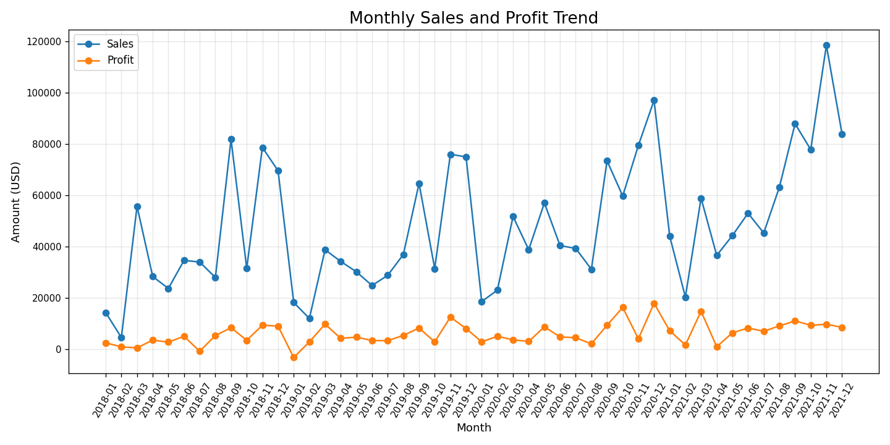
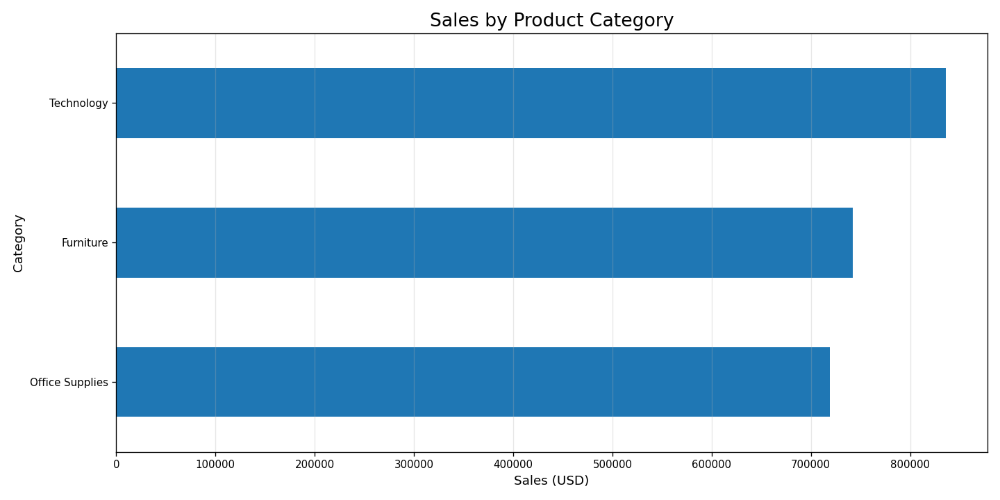
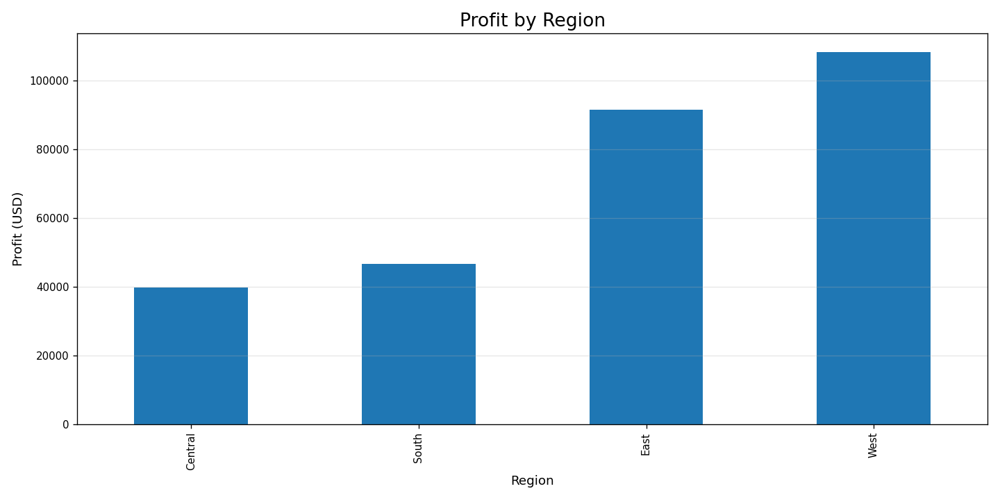
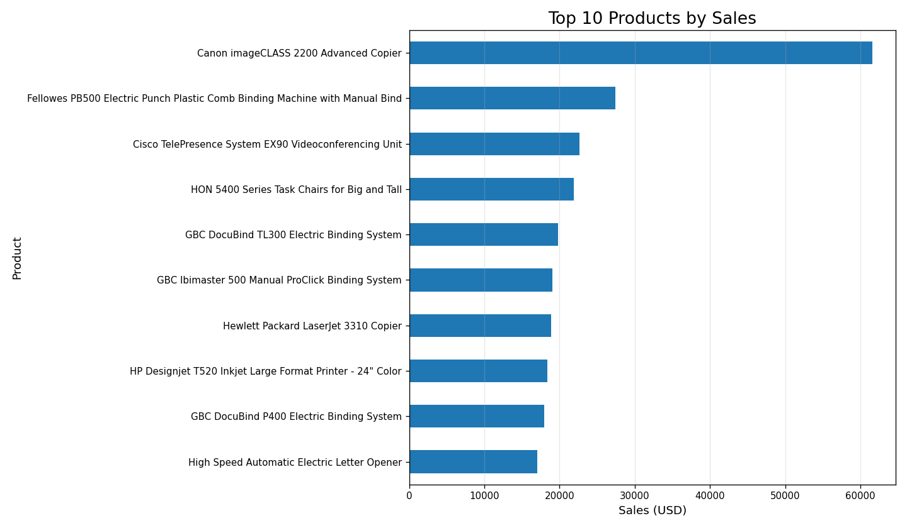
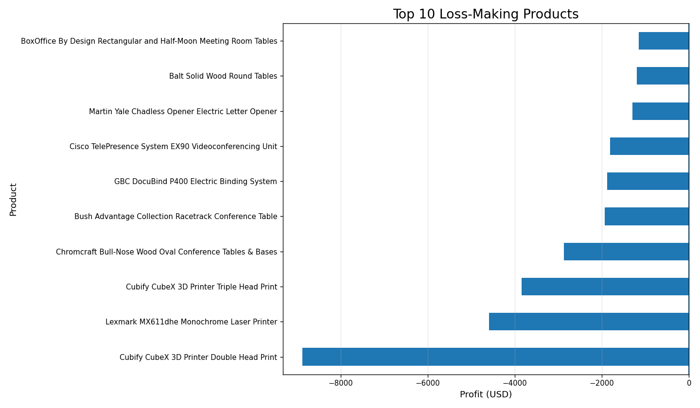
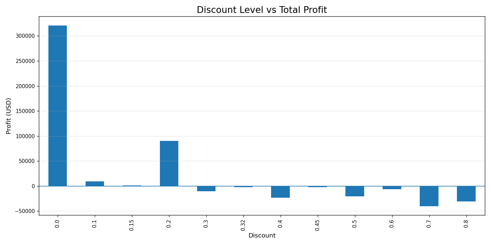

# 📊 Retail Sales Analytics
### End-to-End Data Analytics Project | Python · PostgreSQL · SQL

An end-to-end retail analytics project analysing 9,994 Superstore transactions to uncover revenue trends, profitability drivers, customer behaviour, and regional performance.

From raw data cleaning to advanced SQL analysis, this project demonstrates a complete data analytics workflow.

---

## 🎯 Project Highlights

| Metric | Result |
|:--|--:|
| 💰 Total Revenue | **$2,297,200.86** |
| 📈 Total Profit | **$286,397.02** |
| 📊 Profit Margin | **12.47%** |
| 🛒 Total Orders | **5,009** |
| 👥 Unique Customers | **793** |
| 📦 Unique Products | **1,862** |
| Units Sold | **37,873** |
| Average Order Value | **$458.61** |

## 🔍 Business Insights

**1. Regional Performance**

The West region generated the highest revenue ($725,457.82) and profit ($108,418.45).

**2. Category Performance**

Technology led the categories with $836,154.03 in revenue and $145,454.95 in profit.

**3. Profitability Opportunity**

Furniture generated $741,999.80 in revenue but achieved only a 2.49% profit margin, indicating an opportunity to review costs and pricing.

**4. Customer Behaviour**

781 out of 793 customers made repeat purchases, representing a 98.49% repeat-customer rate.

**5. Product Performance**

Canon imageCLASS 2200 Advanced Copier was the highest-revenue product, generating $61,599.82.

**6. Loss-Making Products**

Cubify CubeX 3D Printer Double Head Print recorded a loss of $8,879.97.

**7. Discount Analysis**

Discount levels of 30% and above were associated with negative aggregate profit. This is an observed relationship, not proof that discounts alone caused the losses.

---

## 🛠️ Technology Stack

| Category | Technologies |
|:--|:--|
| Programming | Python |
| Data Manipulation | Pandas, NumPy |
| Visualisation | Matplotlib, Seaborn |
| Database | PostgreSQL |
| Query Language | SQL |
| Development | VS Code, pgAdmin |
| Version Control | Git, GitHub |

---

## ⚙️ Project Workflow

```text
Raw Superstore Dataset
         |
         v
Data Cleaning & Validation
         |
         v
Exploratory Data Analysis
         |
         v
PostgreSQL Database
         |
         v
Business & Advanced SQL Analysis
         |
         v
Data Visualisation
         |
         v
Business Insights & Reporting
```

### 1. Data Cleaning
- Standardised column names.
- Converted dates and numerical data types.
- Checked duplicates and missing values.
- Validated essential fields and business rules.
- Preserved all 9,994 records.

### 2. Exploratory Data Analysis
- Calculated business KPIs.
- Analysed sales and profitability.
- Investigated customer and product performance.
- Compared category and regional results.

### 3. SQL Analytics
- Business KPI calculations.
- Monthly and year-over-year revenue analysis.
- Window functions and product ranking.
- Repeat customer analysis.
- Cumulative revenue.
- Shipping performance.
- Product profitability analysis.

### 4. Data Visualisation
Created six charts to communicate business performance and analytical findings.

---

## 📊 Visualisations

### Monthly Sales & Profit Trends


### Sales by Category


### Profit by Region


### Top 10 Products


### Top 10 Loss-Making Products


### Discount vs Profit


---

## 📁 Repository Structure

```text
sales-analytics-project/
│
├── data/
│   ├── raw/
│   │   └── superstore.csv
│   └── processed/
│       ├── superstore_cleaned.csv
│       ├── data_quality_report.csv
│       ├── business_kpis.csv
│       ├── category_performance.csv
│       ├── monthly_trends.csv
│       ├── regional_performance.csv
│       ├── top_products.csv
│       ├── loss_making_products.csv
│       └── discount_analysis.csv
│
├── reports/
│   ├── figures/
│   ├── business_insights.md
│   ├── sql_kpi_results.txt
│   └── sql_advanced_results.txt
│
├── sql/
│   ├── 01_schema.sql
│   ├── 02_data_quality.sql
│   ├── 03_sales_kpis.sql
│   └── 04_advanced_analysis.sql
│
├── src/
│   ├── data_cleaning.py
│   ├── eda.py
│   └── visualizations.py
│
├── requirements.txt
├── .gitignore
└── README.md
```

---

## 🚀 How to Run

### 1. Clone the repository

```bash
git clone https://github.com/nithyaa-d/sales-analytics-project.git
cd sales-analytics-project
```

### 2. Create and activate a virtual environment

```bash
python -m venv venv
```

Windows:

```bash
venv\Scripts\activate
```

### 3. Install dependencies

```bash
pip install -r requirements.txt
```

### 4. Run Python scripts

```bash
python src/data_cleaning.py
python src/eda.py
python src/visualizations.py
```

### 5. Set up PostgreSQL

Create a database named `sales_analytics`.

Execute the schema:

```bash
psql -U postgres -d sales_analytics -f sql/01_schema.sql
```

Import the cleaned dataset from the PostgreSQL `psql` prompt:

```sql
\copy raw_superstore FROM 'data/processed/superstore_cleaned.csv' WITH (FORMAT CSV, HEADER TRUE, ENCODING 'UTF8');
```

Run the SQL analysis scripts:

```bash
psql -U postgres -d sales_analytics -f sql/02_data_quality.sql
psql -U postgres -d sales_analytics -f sql/03_sales_kpis.sql
psql -U postgres -d sales_analytics -f sql/04_advanced_analysis.sql
```

---

## 💡 Skills Demonstrated

- Python programming and data manipulation
- SQL querying and advanced analytical techniques
- PostgreSQL database design and management
- Data cleaning and data quality validation
- Exploratory data analysis
- Business KPI development
- Customer and product analytics
- Data visualisation
- Business reporting and insight generation

---

## 👩‍💻 Author

**Nithya Doresha**

Data Analyst | BI Analyst | Analytics Engineer

📍 Gothenburg, Sweden  
🌍 Open to relocation anywhere within Sweden.

[LinkedIn](https://www.linkedin.com/in/nithyad2608/) · [GitHub](https://github.com/nithyaa-d)

